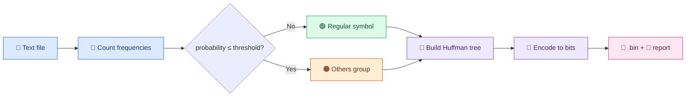

<div align="center">


<br/>


**Standard Huffman coding when the threshold is `0`. A compact, tunable variant when it isn't.**

[Features](#-features) · [How it works](#-how-it-works) · [Usage](#-usage) · [Example](#-example) · [Library](#-use-it-as-a-library) · [Limitations](#-notes-and-limitations) · [Team](#-team)

</div>

---

## ✨ Features

| | |
|---|---|
| 🌳 **Standard Huffman** | Set the threshold to `0` and you get classic Huffman coding |
| 🎚️ **Tunable "Others" group** | Rare symbols share one short escape code plus a fixed-length code |
| 🎯 **Deterministic output** | Ties are broken by creation order, so the same input always gives the same bits |
| 💾 **Binary + report** | A packed `.bin` file and a readable `.txt` report with every code table |
| 🔁 **Round trip** | Decompress from the `.bin` and the report back to the exact original text |
| 📊 **Size stats** | Prints original size, compressed size and compression ratio |
| 🌍 **UTF-8 support** | Works with any characters in a UTF-8 text file |

---

## ⚙️ How it works



1. **Count frequencies** of every distinct character.
2. **Assign fixed-length codes** to each character, using `ceil(log2(n))` bits for `n` distinct symbols, in sorted order.
3. **Split by probability.** A symbol with probability less than or equal to the threshold joins a single pseudo-symbol called `Others`.
4. **Build the Huffman tree** from the regular symbols plus `Others` using a min-heap.
5. **Encode.**
   - 🟢 Regular symbol → its Huffman code
   - 🟠 Rare symbol → the `Others` code followed by its fixed-length code
6. **Pack into bytes.** The bit string is zero-padded to a multiple of 8 bits, and the padding length is saved in the report.

<details>
<summary><b>🔍 Tie-breaking details</b></summary>

<br/>

When two nodes have the same frequency, the one created earlier is taken first. Leaf nodes are ordered by first appearance in the text, and merged nodes always come after every node created before them. This makes the output reproducible. Other valid Huffman implementations may break ties differently and produce different bit patterns with the same total length.

</details>

---

## 🚀 Usage

Save the script as `modified_huffman.py` and run:

```bash
python modified_huffman.py
```

```text
==========================================
      Modified Huffman Coder Menu
==========================================
1. Compress a file
2. Decompress a file
3. Exit
```

### 🗜️ Compress (option 1)

| Prompt | Example | Notes |
|---|---|---|
| Input file name | `bb` | `.txt` is added if there is no extension |
| Output binary file | `bb_comp` | `.bin` is added if there is no extension |
| Output report file | `bb_report` | `.txt` is added if there is no extension |
| Minimum symbol probability | `0` | Symbols at or below this go into `Others`. Invalid input defaults to `0.05` |

### 📂 Decompress (option 2)

| Prompt | Example |
|---|---|
| Compressed binary file | `bb_comp` |
| Report file | `bb_report` |
| Output restored file | `bb_restored` |

> [!IMPORTANT]
> Decompression needs **both** the `.bin` file and the report `.txt` file, because the report holds the code tables.

---

## 🧪 Example

Input text (`bb.txt`):

```text
BEE$BEE$BEAD
```

Compressed with threshold `0` (standard Huffman):

| Symbol | Frequency | Code |
|:---:|:---:|:---|
| `E` | 5 | `0` |
| `B` | 3 | `10` |
| `$` | 2 | `110` |
| `A` | 1 | `1110` |
| `D` | 1 | `1111` |

Encoded bit string (**25 bits**):

```text
1000110100011010011101111
```

The `.bin` file stores these 25 bits padded with seven zeros to 32 bits (4 bytes).

---

## 📦 Output files

| File | Contents |
|---|---|
| 💾 **`.bin`** | The packed, padded bit stream |
| 📝 **`.txt` report** | Threshold used, fixed-length codes, Huffman codes, the `Others` code (if any), the encoded bit string, and a decoder payload |

> [!WARNING]
> Do not edit or delete the `--- DECODER PAYLOAD ---` section of the report, or decompression will fail.

---

## 🐍 Use it as a library

```python
from modified_huffman import ModifiedHuffmanCoder

coder = ModifiedHuffmanCoder(prob_threshold=0.0)
bits, metadata = coder.fit_and_encode("BEE$BEE$BEAD")

print(bits)                       # 1000110100011010011101111
print(metadata["huffman_codes"])  # {'E': '0', 'B': '10', ...}

print(coder.decode(bits))         # BEE$BEE$BEAD
```

---

## 📝 Notes and limitations

> [!NOTE]
> The reported compression ratio counts only the `.bin` file. The report holds the code tables, so a fair storage comparison should include it. For small inputs the metadata can be larger than the compressed data.

- Input must be valid UTF-8 text. Binary files are not supported.
- The whole file is read into memory and the bit string is a Python string, so very large files will be slow and memory-hungry.
- Decoding scans the code table for each symbol. That is fine for small alphabets but not optimized for speed.
- If the input is a single repeated symbol, that symbol gets a one-bit code.
- An empty input file produces no code tables, so it cannot be decompressed.

---

## 👥 Team

<div align="center">


**Badr Rafik** · **Kareem Ahmed** · **Mohamed Saed**

</div>

---

<div align="center">

Made with 🌳 and a lot of bits

</div>
